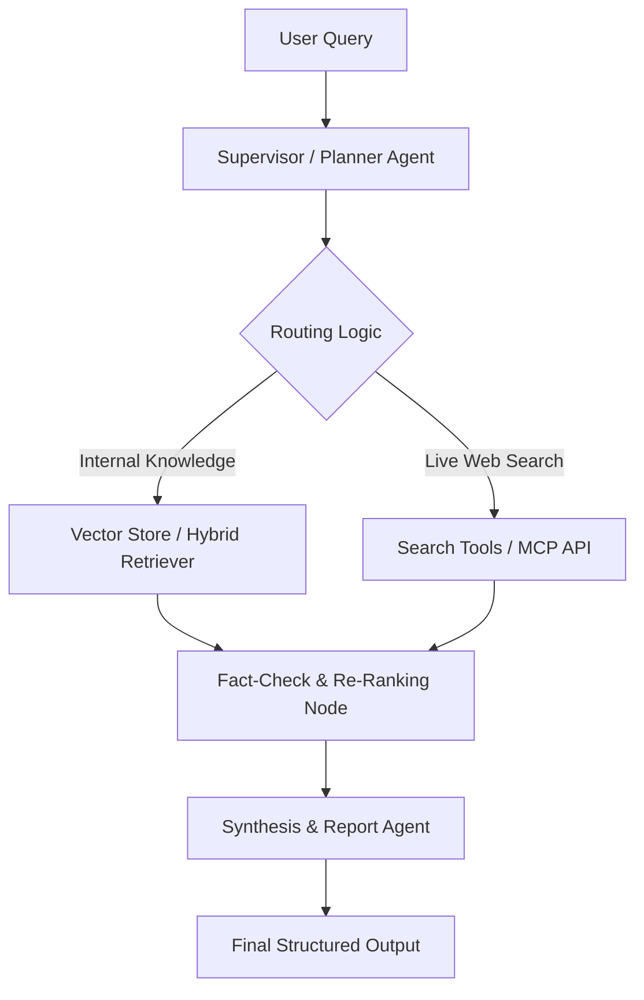

# 🤖 Autonomous Multi-Agent Research & Analysis System

An end-to-end **Agentic AI research workflow** designed to decompose complex user queries, retrieve relevant information, perform fact-checking, and synthesize structured analytical reports.

The system is built around **LangGraph**, **LangChain**, **Advanced RAG**, and **MCP/tool integration**, with an architecture designed to support stateful agent orchestration, routing, validation, and structured outputs.

> 🚧 **Project Status:** In active development.  
> The architecture and components described below define the target implementation and will be updated as the system is built and evaluated.

---

## 🌟 Key Features

- **Hierarchical Agent Orchestration**: Stateful graph orchestration with `LangGraph`, supporting routing, cycles, fallbacks, and future human-in-the-loop validation.
- **Adaptive RAG & Routing**: Routes requests between internal knowledge retrieval, real-time web/tool research, and structured APIs.
- **Multi-Agent Collaboration**:
  - `Planner Agent`: Deconstructs complex research queries into smaller tasks.
  - `Research & Retriever Agent`: Retrieves relevant context and uses available tools.
  - `Fact-Checker Agent`: Validates retrieved evidence and checks citations against source material.
  - `Synthesis Agent`: Combines verified findings into a structured analytical report.
- **Tool Integration via MCP**: Designed to integrate Model Context Protocol (MCP) servers and external function tools.
- **Structured Task Management**: Agent tasks are represented with validated schemas and tracked through explicit workflow states.

---

## 🏗️ System Architecture



### Agent Workflow

```text
User Goal
   ↓
Planner
   ↓
Task Queue
   ↓
Research / Retrieval
   ↓
Fact Checking
   ↓
Synthesis
   ↓
Structured Report
```

The implementation is being developed incrementally, starting with the task schema and LangGraph state layer before adding the research agents, API layer, and UI.

---

## 🛠️ Tech Stack

| Layer | Technology |
|---|---|
| Language | Python 3.11+ |
| Agent Orchestration | LangGraph |
| LLM Framework | LangChain |
| LLM Providers | OpenAI / Anthropic |
| RAG | Vector retrieval + reranking |
| Vector Database | ChromaDB / Pinecone |
| Embeddings | `text-embedding-3-small` |
| Reranking | Cohere Rerank |
| Tool Integration | MCP |
| Observability | LangSmith / OpenTelemetry |
| Evaluation | Ragas |
| API | FastAPI |
| UI | Streamlit or Next.js |

> Components may be introduced progressively as development continues.

---

## 📁 Repository Structure

```text
autonomous-multi-agent-researcher/
│
├── agents/
│   ├── planner.py
│   ├── researcher.py
│   ├── fact_checker.py
│   ├── synthesizer.py
│   └── llm.py
│
├── models/
│   └── task.py
│
├── graph/
│   ├── state.py
│   └── workflow.py
│
├── rag/
│   ├── embeddings.py
│   ├── vectorstore.py
│   └── retriever.py
│
├── optimization/
│   ├── tokens.py
│   ├── budget.py
│   └── claims.py
│
├── tools/
│   └── web_search.py
│
├── scripts/
│   └── ingest.py
│
├── data/
│   └── sample_laptop_cooling.txt
│
├── config/
│   └── settings.py
│
├── tests/
│   ├── test_task.py
│   ├── test_workflow.py
│   ├── test_rag.py
│   ├── test_web_search.py
│   └── test_optimization.py
│
├── .env.example
├── requirements.txt
├── main.py
└── README.md
```

The repository structure will evolve as new components are implemented.

---

## 🚀 Development Roadmap

### Sprint 1 — Data Schema & State Core ✅

- [x] Define Pydantic `Task` schema (with validated status transitions)
- [x] Define LangGraph `AgentState`
- [x] Create initial `StateGraph` (planner → researcher → fact-checker → synthesizer)
- [x] Test task state transitions

### Sprint 2 — Core Agents ✅

- [x] Implement Planner Agent (mock + LLM structured output)
- [x] Implement Research / Execution Agent (RAG → web search → model fallback)
- [x] Integrate basic RAG retrieval (ChromaDB + embeddings + Cohere rerank hook)
- [x] Implement Reviewer / Fact-Checker Agent (two-stage: exact-match + LLM review)
- [x] Add task retry flow (`NEEDS_RETRY` with `max_retries`)
- [x] Token optimization module (per-node budgets, cost reporting)

### Sprint 3 — Backend API

- [ ] Create `POST /goals`
- [ ] Create `GET /tasks`
- [ ] Create `POST /tasks/{id}/run`
- [ ] Connect API endpoints to the LangGraph workflow

### Sprint 4 — UI & Demo

- [ ] Build Kanban-style task dashboard
- [ ] Display task state and agent results
- [ ] Add auto-refresh / polling
- [ ] Add `.env.example` and setup documentation
- [ ] Record a short project demonstration

---

## ⚡ Quickstart

### 1. Clone the repository

```bash
git clone https://github.com/zanods/autonomous-multi-agent-researcher.git
cd autonomous-multi-agent-researcher
```

### 2. Create a virtual environment

```bash
python -m venv venv
```

Activate it:

**Windows**

```powershell
.\venv\Scripts\activate
```

**macOS / Linux**

```bash
source venv/bin/activate
```

### 3. Install dependencies

```bash
pip install -r requirements.txt
```

### 4. Configure environment variables

Create `.env` from `.env.example`:

```bash
cp .env.example .env
```

Example configuration:

```env
OPENAI_API_KEY=your_openai_api_key_here
COHERE_API_KEY=your_cohere_api_key_here
PINECONE_API_KEY=your_pinecone_api_key_here
LANGCHAIN_API_KEY=your_langchain_api_key_here
LANGCHAIN_TRACING_V2=true
```

> Never commit real API keys or other secrets to the repository.

### 5. Run the pipeline

Mock mode runs with no API keys (deterministic sample outputs, great for testing the graph):

```bash
python main.py --query "Evaluate the impact of high-TDP laptop cooling designs on sustained clock speeds"
```

Live mode uses real LLMs and tools — set keys in `.env` first (see `.env.example`):

```bash
python scripts/ingest.py   # optional: load your docs into ChromaDB
python main.py --query "..." --live
```

---

## 📊 Evaluation & Benchmarks

Evaluation will be added after the core pipeline is implemented.

The project will use the **Ragas framework** to evaluate retrieval and generation quality on a domain-specific test set.

| Metric | Baseline RAG | LangGraph Multi-Agent RAG |
|---|---:|---:|
| Context Relevance | TBD | TBD |
| Faithfulness | TBD | TBD |
| Complex Task Completion Rate | TBD | TBD |

### Planned evaluation goals

- Measure retrieval relevance.
- Measure answer faithfulness to retrieved context.
- Compare baseline RAG against the multi-agent workflow.
- Evaluate performance on complex, multi-step research queries.

---

## 🔐 Security

- Keep API keys in `.env`.
- Use `.env.example` for configuration templates.
- Never commit secrets, credentials, or private source documents.
- Treat external tool output as untrusted input and validate it before passing it into downstream agents.

---

## 📌 Project Status

**✅ Sprints 1–2 complete**

Done:

1. Pydantic `Task` schema with validated status transitions
2. LangGraph `AgentState` + `StateGraph` (planner → researcher → fact-checker → synthesizer)
3. Core agents: RAG via ChromaDB, Tavily web search, retry flow
4. Token optimization: two-stage fact-check, per-node budgets, cost reporting
5. 15 pytest tests passing

Next up: FastAPI backend (Sprint 3), then Streamlit UI + demo (Sprint 4).

---

## 📄 License

This project is licensed under the **MIT License**. See [`LICENSE`](LICENSE) for details.
